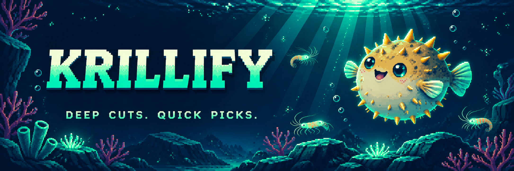

<p align="center">
  
  
  
  
</p>

# Krillify

**Three obscure picks. Right beside the puffer.**

Krillify is an unofficial Chrome/Edge companion for [Krillion's Puffer Party](https://krillion.io/party). It reads the category on the page and brings answer suggestions into the game, so you can stay focused on your turn.

Click a suggestion to fill the answer box, then submit it yourself. Krillify tracks your submitted answers for the current game and makes them available again in the next one.

> **v1.2.0** adds structured game-state detection with a DOM fallback, historical accepted-answer tracking, five original starter banks, and one bounded retry for a fast server failure. Rarity and acceptance remain estimates; this release has not been benchmarked against other extensions in live matches.

## What it does

| Feature | Behavior |
| --- | --- |
| Automatic prompt detection | Reads game snapshots/patches; falls back to the visible category |
| Three suggestions | Shows up to three obscure, unused answers, with the best estimated pick first |
| Click to fill | Inserts an answer into the game box; you still press Enter |
| Game-scoped memory | Excludes submitted answers and known aliases during the current game |
| Opponent tracking | Reads accepted game events and bubbles, removes used suggestions, and fills the gaps |
| Local cache | Keeps answer lists across games and browser restarts |
| Starter banks | Five exact prompts work without a key; acceptance unverified |
| Answer bank imports | Supports your own JSON lists without an API key |
| On-page panel | Drag it, minimize it, or pick the prompt manually |

## Install

No build step, package install, or server is needed.

1. Download this repository using **Code → Download ZIP**, then extract it. You can also clone it:

   ```sh
   git clone https://github.com/SpookyJumpyBeans/krillify.git
   ```

2. Open `chrome://extensions` in Chrome or `edge://extensions` in Edge.
3. Enable **Developer mode** and click **Load unpacked**.
4. Select the **`extension` folder inside this repository**. That is the folder containing `manifest.json`.
5. Open Krillify from the browser's Extensions menu.
6. Add your [OpenAI API key](https://platform.openai.com/api-keys), enable recommendations, and save. The default model is `gpt-4.1-mini`; your account must have access to the configured model.
7. Refresh Krillion and enter a Puffer Party room.

**The source is free. AI requests use your own API account and may incur charges.** There are no shared keys or credits bundled in the extension. Without a key, five starter prompts and your imported banks work locally. Starter prompts: "Name an insect", "Name an egg dish", "Name a country in East Africa", "Name something that uses steam", and "Name a building material". These original lists contain 57 candidates, ordered by estimated obscurity; they are not verified against the game's answer database.

## During a game

- **Click an answer** to fill the input. Filling or viewing a suggestion does not mark it used.
- **Submit in the game** to add that answer to the current game's exclusion list. Manually typed answers are tracked too. Submission attempts are remembered even if the game rejects them.
- **Next 3** temporarily skips the current suggestions and offers another batch. It does not permanently exclude answers you only viewed.
- **New game, fresh used list.** The helper uses the server game identity when available, with lobby, countdown, game-over and category-counter transitions as a fallback. Ordinary category changes keep the same game's list.
- **Refreshes in the same tab** retain the game identity. Tabs observing the same server game share its used list; the DOM fallback uses a per-tab identity.
- **Pick prompt** lets you click the category text if automatic detection misses it.

**Opponents' accepted answers are tracked automatically.** Krillify reads accepted answers from game snapshots/patches and watches accepted-answer bubbles, adds them to the same game-scoped exclusion list, removes only the matching visible suggestions (including known aliases), and fills each freed slot so three answers stay on screen. It also checks answers that arrive while a suggestion request is running. Typing previews, rejected guesses and chat do not count as opponent answers.

Structured tracking can recover earlier accepted answers included in the server event history when you join. If structured tracking is unavailable, tracking covers accepted bubbles rendered while the helper runs. A server history that has already been truncated cannot be recovered. Known aliases are matched; unknown alternate names can still slip through.

## Bring your own answers

In Settings, choose a JSON file under **Instant answer banks**. Map prompt text to lists ordered from most obscure to less obscure:

```json
{
  "Name an egg dish": [
    {
      "answer": "Oeufs en meurette",
      "aliases": ["Eggs in meurette"],
      "note": "Poached eggs in a Burgundian red wine sauce"
    },
    "Chawanmushi",
    "Gyeran-jjim"
  ]
}
```

These are format examples, not verified entries from Krillion's accepted-answer database. Prompt matching ignores case and punctuation. Imports merge into the local cache without clearing used answers.

## Speed and limits

The page checks for a prompt every **200 ms**. Cached answers avoid the API round trip. A new or exhausted prompt asks the model for up to **18 candidates**, then keeps the extras for later choices. The cache holds up to **300 prompts**, with up to **60 candidates each**.

Cold prompts can take several seconds. The API request has a **14-second deadline** and extension messaging an **18-second deadline** for suggestions. Requests for superseded prompts are cancelled; cancellation does not guarantee that an already-processed request is unbilled. A partial cached batch appears immediately, and any empty slot is topped up in the background while the shown answers stay put.

Fast HTTP 5xx failures get one retry after 750 ms, within the messaging deadline. Billing, authentication, rate limits and slow timeouts are not retried automatically. If recommendations stall, try **Retry**, reload the extension, and refresh the game. See [troubleshooting](docs/TROUBLESHOOTING.md).

## Privacy

The API key, cache, and used-answer records stay in this browser profile's extension storage. They are not synced. The key is not encrypted locally, but storage access is restricted to extension pages and the background worker.

OpenAI requests contain the category, excluded/cached answer names, and your API authentication. They do not include room chat, player identities, cookies, or room credentials. Requests set `store: false`. No analytics or developer-operated backend is included.

A read-only page-world adapter observes Puffer Party WebSocket/SSE messages locally and forwards only game identity, phase, category, and accepted answer names/tiers to the overlay. It does not send game actions. It never forwards chat, player identities, cookies or room credentials to the worker or API.

The extension runs on `krillion.io` and `www.krillion.io`; its declared remote API host is `api.openai.com`. Read the [manifest](extension/manifest.json) and [implementation write-up](docs/WRITEUP.md) for details.

## Inside the repository

```text
extension/      Load this folder into Chrome or Edge
assets/         Original README banner
docs/           Design write-up, troubleshooting, and artwork notes
```

The extension is plain JavaScript, HTML, and CSS using Manifest V3. There are no runtime package dependencies. To check JavaScript syntax with Node.js installed:

```sh
node --check extension/background.js
node --check extension/content.js
node --check extension/game-events.js
node --check extension/core.js
node --check extension/options.js
node tests/game-events.cjs
node tests/worker-v120.cjs
```

## Contributing

Useful contributions include verified answer banks, prompt-detection examples, and reproducible bug reports. Include your browser version, extension version, prompt text, and exact error message. Keep API keys and private room details out of reports.

Krillify is an independent project, not affiliated with or endorsed by Krillion. The banner is original AI-generated artwork, not an official game asset. Code is available under the [MIT license](LICENSE).
