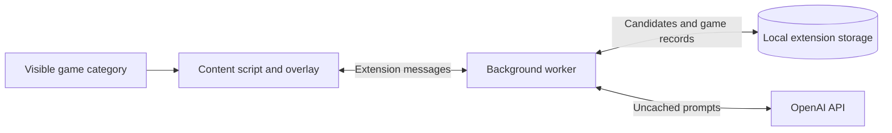

# Building Krillify

## The problem

Puffer Party is a category game played under time pressure. Switching to a chat window, copying a question, and returning to the game takes too long. Krillify moves that interaction into the browser: read the visible category, find obscure candidates, and show three beside the game input.

Version 1.1.1 is the base for this small, inspectable implementation. Published branding changes the displayed name to Krillify. Accepted opponent-answer tracking was added separately, without importing the later experimental prompt or messaging changes.

## Three parts, one local profile

The content script polls the game DOM every 200 milliseconds. Its shadow-root panel is separate from the game’s styles. When the category changes, it sends the prompt and current game identifier to a module service worker. The worker reads cached candidates, excludes used answers, and returns up to three choices. Only an exhausted cache requires a model request.

The worker owns API access and local data. The content script never receives the API key. Storage is restricted to trusted extension contexts, and model requests go directly to OpenAI rather than through a project backend.

## A suggestion is not a used answer

The answer bank and the current game’s used list serve different purposes. Cached candidates should survive across games; used answers should not prevent the best choices from returning in a new game.

Krillify assigns each game a local scope derived from the room path and a random identifier. It watches the game’s lobby, countdown, game-over label and category counter to detect a new game. Same-tab session storage preserves the identifier through a refresh. Used-answer records remain scoped to that identifier, while the candidate cache is shared across games.

Viewing or filling an answer does not exclude it. Enter, form submission, and the game’s Send answer button record your submission attempts, including rejected attempts. Known aliases are expanded from cached candidates. Names are normalized for case, punctuation and accents.

Opponent tracking uses a MutationObserver over the rendered game. The inspected renderer marks accepted pass bubbles with `pf-say ok` and restored accepted answers with `pf-say rest`, inside a player’s `pf-seat`. Only those signals enter the used list. Typing previews, rejected guesses and ordinary chat are ignored. No game traffic is intercepted.

New accepted answers immediately remove matching choices from the overlay. A debounced replacement request reuses the existing cache and history path. An in-memory exclusion set also filters replies from requests already in flight. Bubble fingerprints avoid duplicate tracking when a pass animation becomes a resting label. On a new game, the set is cleared and lingering old bubbles are suppressed until they change. Earlier accepted answers no longer rendered when the helper starts remain unobservable.

## Keeping costs and latency down

A model request asks for up to 18 candidates in JSON, ordered by estimated obscurity. The worker stores unused candidates so later batches can be served locally. Imported banks use the same selection path, making a no-key mode possible for covered prompts.

Network requests run outside the storage queue. Only state changes are serialized, so a slow request from one tab does not hold up another tab’s cache lookup. The active request for a tab is cancelled when superseded. A second history check before returning answers handles submissions that happened while generation was running.

The cache is bounded at 300 prompts and 60 candidates per prompt. This keeps storage finite, but it also means older categories may be evicted. Imported banks should be kept separately as source files.

## Where the approach falls short

Obscurity is a model estimate, not a lookup into Krillion’s private rarity table. A plausible, real answer can still be absent from the game’s curated answer set. Asking for established entities and canonical names reduces ambiguity without eliminating it.

DOM polling depends on the game’s markup and animation classes. The preserved 1.1.1 selector can miss a category during transitions. The release also has known intermittent background-message timeout reports. A successful isolated request does not establish reliable operation throughout a live match.

The extension deliberately keeps submission manual. Clicking a recommendation fills the input through the native input setter and dispatches an input event, but it does not submit the answer or play turns automatically.

## Validation for this publication

The four JavaScript files were syntax-checked and manifest references were checked against the packaged files. The original publication matched the restored v1.1.1 baseline apart from displayed branding. The subsequent opponent-tracking change was tested in a browser fixture using the actual worker selection/history logic: accepted aliases remove suggestions and trigger cached replacements, chat/typing/rejections are ignored, repeated resting bubbles do not create new requests, answers arriving during generation are filtered, and the next game can reuse previous opponent answers. No API key, browser profile, generated cache, room history or local debugging archive is included in the repository.

This publication does not claim that later-version browser tests validate every v1.1.1 behavior. A live match was not run as part of preparing this repository.
